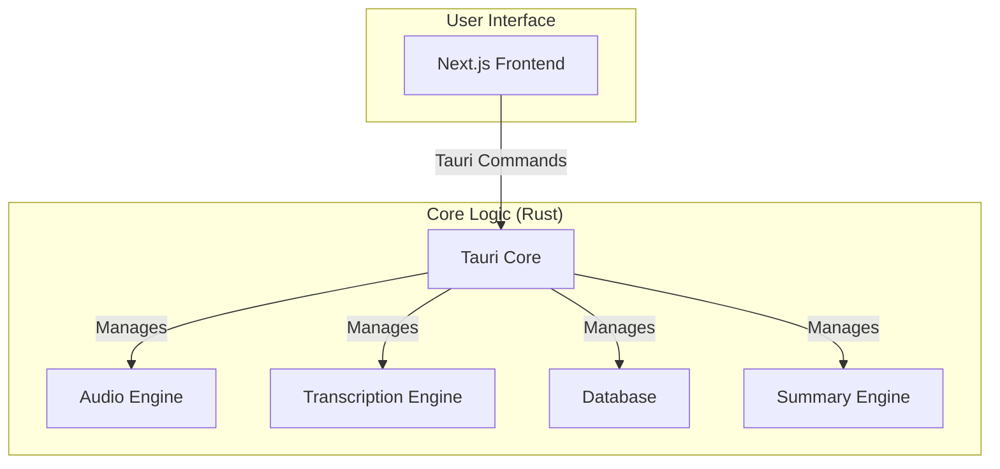

# System Architecture

Meetily is a self-contained desktop application built with [Tauri](https://tauri.app/). It combines a Rust-based backend with a Next.js frontend into a single, efficient, and cross-platform application.

## High-Level Architecture Diagram

## Component Details

### Frontend (Next.js)

*   Provides the user interface for managing meetings, displaying transcriptions, and configuring the application.
*   Communicates with the Rust core through Tauri's command system.

### Backend (Rust Core)

*   **Tauri Core:** The heart of the application, responsible for managing the window, handling events, and exposing the Rust core to the frontend.
*   **Audio Engine:** Captures audio from the microphone and system, processes it, and prepares it for transcription.
*   **Transcription Engine:** Uses local speech-to-text models (Whisper or Parakeet) to transcribe the captured audio. It can be accelerated with a GPU.
*   **Database:** A local SQLite database that stores meeting metadata, transcripts, and summaries.
*   **Recording folders:** Each meeting's audio, transcripts, and metadata live in a folder directly inside the recordings folder (`meetings.folder_path`). Deleting a meeting (`api_delete_meeting`) removes the database rows first, then moves that folder to the system Trash. Only a direct child of the configured or default recordings folder is moved, never the recordings folder itself, and not if another meeting still uses the folder. If the move does not happen, the deletion still succeeds and the response gives `audio_kept_reason`, which the UI shows.
*   **Summary Engine:** Generates meeting summaries using various Large Language Models (LLMs), including local models via Ollama.
